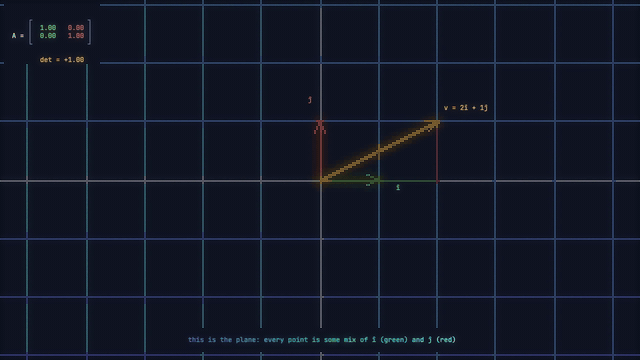
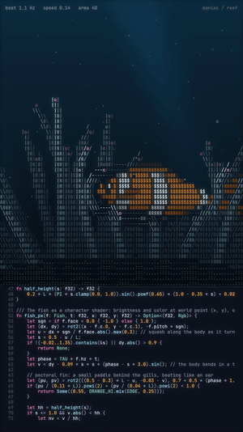
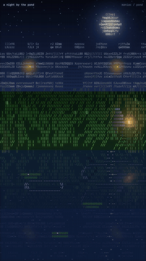

# maniac

A small ASCII animation engine in Rust. It borrows manim's best idea (a timeline of
animations you play one after another) but skips the object system. Every animation here
is just a function of time:

```rust
s.play(1.5, |c, k| c.neon(&circle.partial(k.p), rainbow));
```

`c` is the canvas, `k` is the tick (`k.p` is eased progress from 0 to 1, `k.time` is
seconds since the scene began). Draw whatever you like in there: maths, a fish in an
anemone, a pond at night, fireworks, a title card.

One library file (`src/lib.rs`), no dependencies.

| matrix | reef | pond |
|---|---|---|
|  |  |  |

Full videos: [matrix.mp4](media/matrix.mp4), [reef.mp4](media/reef.mp4), [pond.mp4](media/pond.mp4).

## Run it

```sh
cargo run --release --example showcase                         # plays in your terminal
cargo run --release --example matrix -- --html matrix.html     # bakes an HTML player
cargo run --release --example reef -- --html reef.html         # portrait scenes pick 90x80
cargo run --release --example pond -- --html pond.html --size 60x54
```

| example    | what it shows |
|------------|---------------|
| `hello`    | the smallest scene: draw a circle, morph it into a star, type a line |
| `showcase` | a 50-second tour of everything: morphs, graphs, Fourier, 3D, shaders, fireworks |
| `matrix`   | linear transformations: shear, rotation, composition, determinants, eigenvectors |
| `reef`     | a fish drawn with a character shader, weaving through 40 spring-physics anemone arms, with its own source scrolling below |
| `pond`     | moonlit wall, swaying grass, a lantern carrier, fireflies, all mirrored in rippling water |

## Making videos

There are two ways.

- **In the browser:** open a baked `.html` and press `v`. It plays from the start and downloads a WebM, with the bloom included. This records in real time.
- **MP4 from the command line:** `node tools/render.mjs scene.html scene.mp4` drives headless Chrome to draw every frame in JetBrains Mono and pipes them to ffmpeg. It needs Node 22+, Chrome and ffmpeg. A 1080p minute takes a bit over a minute.

The HTML player itself: space pauses, the arrow keys seek, `b` toggles bloom, `v` records,
and clicking the bar jumps.

## The smallest scene

```rust
use maniac::*;

fn main() {
    let mut s = Scene::new();
    let circle = Path::circle(2.0);
    let star = Path::star(5, 2.4, 1.0);

    let c0 = circle.clone();
    s.play(1.5, move |c, k| c.neon(&c0.partial(k.p), rainbow));              // draw it
    s.play(1.5, move |c, k| c.neon(&circle.morph(&star, k.p), SUNSET)).hold(); // morph, then stay
    s.also(1.5, |c, k| c.write((0.0, -3.2), "hello, maniac", k.p, WHITE)).hold(); // at the same time
    s.wait(1.0);

    s.show(); // terminal, or HTML if you pass --html
}
```

## How it works

The world is laid out like manim's. The origin is in the middle, y points up, and the
screen is always 8 units tall, so a circle of radius 2 looks the same at any size. `c.w()`
gives you the half-width.

Each terminal cell is built from three layers:

| layer  | resolution per cell        | used by |
|--------|----------------------------|---------|
| pixels | 2 full-color (`▀` halves)  | `fill`, `shade`, `glow`, `disc`, `big`, `panel` |
| dots   | 8 braille dots             | `line`, `stroke`, `neon`, `arrow`, `grid`, `axes`, `mesh` |
| text   | 1 character                | `text`, `label`, `write`, `ascii`, `glyph_line`, `code`, `surface` |

Text sits on top of the dots, and the dots sit on top of the pixels. Colors are 24-bit
everywhere.

### Timeline (`Scene`)

- `play(dur, f)` runs after everything before it. `also(dur, f)` starts alongside the previous clip. `at(t, dur, f)` starts at an absolute time. `always(f)` runs for the whole scene. `wait(d)` adds a pause.
- Each of those returns a clip you can chain: `.ease(ease::bounce)`, `.hold()`, `.linger(2.0)`, `.until(t)`, `.fade_in(d)`, `.fade_out(d)`. Fades apply to everything the clip draws.
- `s.size = (90, 80)` makes a 9:16 portrait export. `--size COLSxROWS` overrides it from the command line.

### Shapes (`Path`)

`circle`, `rect`, `poly`, `star`, `heart`, `line`, `func(f, x0, x1)`, `param(f)`. You can
transform any of them with `at`, `scale`, `rot`, or `map(any fn)`. `partial(p)` gives you
manim's Create, and `morph(&other, p)` gives you Transform.

### Drawing with characters

- `ascii(ramp, |x, y| Some((brightness, color)))` is a character shader, run on every core. Each cell picks its character from a ramp (`RAMP_DENSE`, `RAMP_SOFT`, `RAMP_DIGITS`, `RAMP_BLOCK`, or your own string) and its color is shaded by brightness. The fish, moon, wall and lily pads are all drawn this way.
- `glyph_line(a, b, ink)` draws a line in `- / | \`, chosen by its slope. `char_line` repeats one character instead. `slope_char(dx, dy)` gives you the character on its own.
- `reflect(y, t, ripple, tint, strength)` mirrors everything above a line into the water below, with a ripple. Draw the scene, call it, then draw things in the water.
- `code(p, src, first, rows, width)` shows highlighted source with line numbers. `include_str!` a file and it can show itself.
- `label` draws left-aligned text, `set(col, row, ch, color)` writes one cell, `cell_at(p)` tells you which cell a point falls in, and `panel` draws a solid box that hides what's under it.

### Physics, still seekable

- `Sim::new(dt, init, step)` steps a simulation forward at a fixed `dt`, and restarts from `init` when time goes backwards. Scenes stay pure functions of time, so seeking, looping and HTML export keep working.
- `Chain::new(root, angle, nodes, length, curl)` is a springy verlet rope. It's pinned at the root and pulled back toward its rest pose, hard near the root and softly near the tip. `step(dt, force)` applies currents or wind, and `push_out(center, r)` keeps it out of the way of a swimmer. It works for seaweed, hair, tails and tentacles.

### Color

You can pass any `ink` argument as a plain `Rgb`, a gradient array (`SUNSET`, `OCEAN`, `NEON`,
`AURORA`, `FIRE`, `ICE`, or your own `[Rgb; N]`), or a closure `|u| rainbow(u + k.time)`.
The helpers are `hsv`, `grad`, `rainbow`, `Rgb::mix` and `Rgb::dim`. `neon_k(path, ink, strength)`
lets you choose how much glow a stroke gets; plain `neon` uses 0.4.

### Extras

`shade` (a pixel shader on every core), `surface` (lit, z-buffered 3D in characters),
`mesh`, `rot3`, `torus`, `sphere`, `cube`, `hash` and `noise` (deterministic randomness),
`stagger` (manim's LaggedStart), `big` (a chunky pixel font), and a full set of easing curves.

## Speed

- The terminal player diffs each frame against the last one and only writes cells that changed, skipping cursor moves and color codes that are already in effect.
- The HTML export stores frames as binary deltas.
- The 50-second showcase (about 1,500 frames at 160×45) bakes in about 1.3 seconds single-threaded inside WebAssembly. The reef (720 frames, with 40 physics chains and a shader) bakes in 0.5 seconds.

## JetBrains Mono

A program can't choose your terminal's font, so set JetBrains Mono in your terminal's own
settings. The HTML player and the MP4 renderer load it from Google Fonts. They draw braille
and half blocks themselves, so those stay crisp.

## Honest limits

- The terminal needs truecolor (iTerm2, WezTerm, Kitty, Alacritty, Ghostty, recent Terminal.app).
- There's no keyboard input in the terminal player. Ctrl-C quits and restores the terminal.
- Terminal sizing and signals use raw Unix calls. Elsewhere it falls back to 120×36.
- Full-screen shaders change every cell in every frame, so baked HTML gets big. The showcase is about 19 MB.
- Text is placed one character per cell, so wide characters (CJK, emoji) break the alignment.
- In-browser recording is real time and WebM only. Use `tools/render.mjs` for frame-exact MP4.
- `lib.rs` is about 1,400 lines with comments. That's short for what it does, but it isn't tiny.
